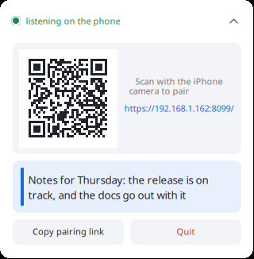

# Dictation Bridge（简体中文）

**在 iPhone 上说话，字就出现在 Windows 电脑当前聚焦的窗口里。**

不用打字，不用凑到键盘，不用停下手上的事。拿着手机，点一下 Start listening，说就行。

  

语言版本：[English](README.md) · [繁體中文](README.zh-Hant.md) · [简体中文](README.zh-Hans.md)

---

## 开始使用

**1. 在电脑上**

下载 `DictationBridge.exe` 运行即可。安装就这一步：没有安装程序，没有运行环境，没有配置。
屏幕中间附近会出现一个小面板。使用期间请保持它运行。

下载包只有这一个文件。手机需要的证书由你自己的电脑在首次运行时生成，所以每个人拿到的
都匹配自己的机器。

**2. 在手机上（只需一次）：信任电脑的证书**

iOS 只在安全页面上开放语音听写，所以电脑用自己的证书提供 HTTPS 页面，手机要先信任它，才能
使用语音听写。在面板上点右键选 **Show the certificate file**，把 `dictation-bridge.cer` 发到手机上、
安装，然后开启信任。这一步**只需一次**，详细步骤见下面的 [设置手机](#设置手机)。

**3. 扫描二维码**

用后置摄像头扫描面板上的二维码，点击弹出的链接即可打开页面，**同时把手机与这台电脑配对**：
二维码里除了地址（形如 `https://192.168.1.162:17123/`），还带有一个配对密钥。

二维码旁边也写着这个地址，但手动输入只能打开页面、无法配对，页面会提示你。如果摄像头扫不出来，
在面板上点 **Copy pairing link**，再把这个链接发到手机上。

**4. 点 Start listening**

如果询问就授予麦克风权限。从这里开始，手机不再需要你操作。

**5. 说话**

直接开始说。你说一句，它就立刻打下去，不用等你把整句讲完。

就这样。你可以把手机放下不用管。

## 唯一需要理解的事

**页面在收音时，你说的每一句都会直接打进当前焦点窗口。** 没有暂停，没有队列，也没有
按键。

这就是现在的全部设计：**手机网页上的 Start 按钮是唯一的开关**，电脑那边也是。点一下
开始输入，再点一下停止。

以前其实更安全。电脑上有个 **Ctrl+Alt+D**，而且面板启动时是暂停的，所以重启一次不会把
文字打进你恰好打开的窗口。现在这第二个开关没有了，所以有一句要诚实讲清楚：**如果你把
收音中的页面放在桌上、电话屏幕朝上，它会听到房间的声音并且打出来。** 把电话放在听不到
房间的位置，或者不用时就点 Stop。

### 怎么看 Start 按钮

按钮上的字**永远不变**，一直都是 **Start listening**。变的是它能不能按，而现在这一点
跟着麦克风走：

| 按钮 | 含义 |
| --- | --- |
| 蓝色，可以按 | 已停止，或者页面已经放弃。点一下开始。 |
| 变灰（按不了） | 页面还在试着听，你说话就会打下去。不用管。 |

一旦真的听不到，按钮会自己回来：麦克风被拒绝、所有语言都试过了、或者手机接受了好几次
收音但一直没打开麦克风。只有这些时候按下去才有用，所以也只有这些时候才会出现可以按的按钮。
所以**变灰就意味着一件事：它还在工作**。

上面那个圆点和那一行字负责细节：*idle*、*starting (zh-HK)*、*listening*、*recovering from
stall*。

### 为什么不等你讲完再打

页面一收到识别器的每一个半成品结果就立刻发出去，只有最后十个字不发。局域网里发几十个
字符，代价基本就是一个包头，所以把字按住不发没有任何好处。

留这十个字是有原因的。Safari 对你刚说完的那几个字还没算完：它会在你说完大约半秒后
改回你正在说的那个词（*"recognize spee"* 变成 *"recognized speech"*）。而已经打到屏幕上的
字拿不回来，所以晚一点发，就等于让它在字还留在手机上的时候改完。实际上大部分听错的词
**根本不会出现在屏幕上**。

这个延迟不会永久：一有最终结果就立刻放，不会让你讲完的句子慢吞吞地出来；停顿、识别结束
和点 Stop 也都会立刻放。最多只是慢了一句的最后十个字。

如果修改真的改到了已经打出来的字（也就是 iOS 改的位置超过十个字之前），那个词就会是错的。
页面不会发送修改，所以不会打两遍，句子也会按顺序继续。

## 日常使用

| | |
| --- | --- |
| 开始／停止输入 | 手机网页上的 **Start listening** |
| 看它是不是真的在收音 | Start 按钮：**变灰**就是麦克风开着。电脑上，面板的圆点会变成绿色并缓慢呼吸 |
| 在手机上打开网页 | 扫描面板上的二维码，同时完成配对 |
| 取消所有手机的配对 | 在面板上点右键选 **Reset phone pairing...**，再扫描新的二维码 |
| 找到要装到手机上的证书 | 在面板上点右键选 **Show the certificate file** |
| 收起面板 | 在面板上点右键选 **Hide the panel**。点击托盘图标就能再唤出来 |
| 说话时点面板 | 尽管点：面板不会抢焦点，文字照样打进你的窗口 |
| 复制配对链接 | 点击面板上的地址 |
| 托盘图标能做的事 | 在面板任意位置点右键，菜单完全一样 |
| 移动面板 | 拖动它。它会记住你放的位置 |
| 查看刚才说了什么 | 收到后立即显示在面板上 |
| 如果端口被占用 | 运行 `DictationBridge.exe --port 8099` |
| 如果二维码里的地址不对 | 运行 `DictationBridge.exe --address 192.168.1.20`，填手机能连到的地址 |

### 说粤语或中文

在手机页面的下拉菜单里选择语言，默认是粤语。

如果你的 iPhone 不接受某个语言，页面会安静地尝试下一个，并告诉你最终用的是哪一个。粤语
会先尝试 `zh-HK`，然后 `yue-HK`，再 `zh-TW`。

> **提示：** 手机自身的听写语言设置会影响结果。如果粤语输出成了普通话，请在
> 设置 > 通用 > 键盘 > 听写 中改为粤语。

### 自动锁定

页面聆听期间会让手机屏幕保持常亮（iOS 16.4 或更新版本），点 Stop 后恢复自动锁定。如果听写时
屏幕仍然会锁定，请把 设置 > 显示与亮度 > 自动锁定 设为**永不**。

手机屏幕锁定后页面会挂起并停止聆听。

## 实际使用效果

收起后的面板，只剩一条窄条。手机在收音时圆点是绿色并缓慢呼吸；网页开着但没在收音时是蓝色；没有
手机时是灰色；有事需要你处理，比如有文字没打出来，就是橙色。托盘图标也是同样的颜色：

  

点右边的箭头或者双击展开，可以看到用于配对手机的二维码、它指向的地址（点一下就复制配对链接），以及最新打出来的文字（你说话的时候会一直往上加）。
还没有手机配对时，面板启动后会直接展开显示二维码，配对成功后会自动收起。
手机需要跟上变化时，比如地址变了或者要安装新证书，面板也会重新展开显示二维码。

## 它会产生的文件

所有内容都放在 exe 旁边的 `data\` 文件夹里，首次运行就会创建。exe 本身不会被修改。
删除整个文件夹即可完全重置，包括证书。

只有一个文件对你重要：**`data\dictation-bridge.cer`**，即需要安装到手机上的证书。
在面板上点右键选 **Show the certificate file** 就能找到它。

另外，`data\pairing-key.txt` 是配对密钥，拿到它就能在这台电脑上输入，所以**千万不要**随错误
报告一起发送。删除它或使用 **Reset phone pairing...**，即可取消所有手机的配对。

## 隐私

你的语音由 **Apple** 转录，因为 Safari 的听写就是这样工作的。文本通过你自己的网络
发送到你自己的电脑。不会发送给我们，也不会发送到任何其他地方。

只有配对过的手机才能输入。配对密钥放在二维码里 `#` 后面的部分，浏览器从不会把这部分发送给任何
服务器，电脑也从不对外提供它：同一 WiFi 上的其他设备打开这个地址只能拿到页面，它发出的每个请求
都会被拒绝。日志里没有密钥，也不再记录你说了什么，只记录输入了多少个字符。

有一点需要如实说明：能看到二维码、拿到手机或电脑 `data\` 文件夹的人都拥有这个密钥。在共享或
公共网络上，有旁人时请把面板收起；不再信任某台手机时，用 **Reset phone pairing...** 将它断开。

## 已知限制

- 手机屏幕需要保持点亮且未锁定。
- 无法输入以**管理员**身份运行的程序。Windows 禁止跨权限级别模拟输入，发生时手机会
  明确提示。
- 它只输入文字，不按键：没有 Enter、Tab 或 Backspace。手机发来的换行会变成一个空格，
  因为 Enter 会发出聊天消息或提交表单。
- 证书列出的是电脑的地址，而不是一个名称。换到证书未列出的地址（比如另一个网络）时，
  手机需要再安装一次新证书。新证书会保留旧地址，所以在家和公司之间来回，每个网络装一次
  就够了。
- 需要 iOS 14.5 或更新版本的 Safari。Chrome、Firefox 以及其他应用内置的浏览器都不行：
  在 iPhone 上只有 Safari 可以使用语音识别。页面在其他浏览器打开时会提示你。

## 设置手机

iOS 只在安全页面上开放语音听写，而且它版本的 Safari 没有「仍要继续」按钮。因此电脑会
运行一个小型 HTTPS 服务器，你需要信任它的证书一次。

**先运行一次程序**，在面板上点右键选 **Show the certificate file**。资源管理器会打开
`data\` 文件夹并选中 `dictation-bridge.cer`。

**再发送到手机。** 用邮件发给自己并在「邮件」App 里点开，或者存到 iCloud Drive 再在
「文件」App 里点开。必须是你自己机器生成的那一份，因为证书对应的是生成它那台电脑的
网络地址。

**安装：**

1. **设置 > 通用 > VPN 与设备管理**
2. 点击 Dictation Bridge 描述文件
3. 点击**安装**

**然后授予信任。** 第二步是很多人会漏掉的，漏掉后应用看起来像是坏了：

4. **设置 > 通用 > 关于本机 > 信任证书设置**
5. 打开 **Dictation Bridge**

**打开页面**：扫描面板上的二维码。二维码带有配对密钥，所以请扫描，不要手动输入地址。

### 只需一次

电脑会在多次运行之间保留证书，因此重启电脑或重新启动应用都不需要重复这个步骤。

手机检查的是地址：证书列出了电脑的地址，页面必须用其中一个打开。当电脑换到证书未列出的
地址时，比如换了网络，或者路由器分配了新地址，程序会生成一张新证书，面板会显示
*new certificate: install it on the phone*。照原样安装一次即可。每张新证书都会保留上一张的
地址，所以笔记本在家和公司之间来回，每个网络装一次之后就不会再要求了。证书有效期五年，
到期前一个月程序会换一张新的，也就是需要再装一次。

程序运行期间会跟随电脑的地址。网络一变，面板就会展开显示新的二维码，并显示
*new address: scan the QR code again*；如果需要新证书，会先提示你安装证书。

更新或重新编译程序后，手机上还开着的页面会自动载入新版本。如果当时正在聆听，页面会先提示，
等你点 Stop 后才载入，不会打断你正在说的话。

## 遇到问题时

**页面提示 "not paired with this PC"。**
页面打开时没有配对密钥，通常是因为手动输入了地址，或者这台手机扫描之后电脑重置了配对。再扫描
一次面板上的二维码即可；有手机被拒绝时，面板会显示 *phone not paired: scan the QR code*。在此
期间说的话会留在手机上，配对后就会输入。

**页面提示没有语音识别。**
证书未受信任。请回到上面“设置手机”的第 4 步，并确认你打开的是 `https://` 而不是 `http://`。

**页面提示只有 Safari 可以使用语音识别。**
页面是在其他浏览器里打开的：Chrome、Firefox，或者聊天应用内置的浏览器。相机扫描二维码时会用
默认浏览器打开。把页面地址复制到 Safari，或者把 Safari 设为默认浏览器后再扫一次二维码。

**页面提示 iOS 不允许语音识别。**
iOS 只有在听写或 Siri 开启时才会运行语音识别。请在 设置 > 通用 > 键盘 中打开听写，然后点
**Start listening**。

**开始正常，停止说话一段时间后安静下来。**
这是正常的。识别器会一直开着等你，就像打电话一样，按钮也会一直是灰的。不想等就再点
一次 **Start listening**。

**页面显示了你说的话，但没有输入。**
看 Start 按钮。如果**变灰**就是麦克风开着、页面在发送，那么问题就在手机和电脑
之间：看它是否显示 *connected to desktop*，以及有没有东西卡在等待发送。

**有一个字打错了，接着下一个字也错。**
意料之中，而且无解：文字是一边听一边打的，打出来的字拿不回来。iOS 大概会在你说完一秒后
才改回它听错的词，那时候那个字已经在屏幕上了。页面不会发送那个改动，所以一个错字不会
蔓延成一整句错的。

**目标程序里没有出现任何内容。**
手机页面会立即说明原因：前台窗口以管理员身份运行；没有窗口获得焦点（电脑已锁定或
休眠）；或者焦点在 Dictation Bridge 的窗口上：面板的菜单，或者重置配对的提示框。点面板本身不会
抢焦点。点击你要输入的窗口，然后再说一遍。没有
输入的文字会在手机的记录里划掉，不会自动重发，因为那时它会落到当时获得焦点的窗口。
面板的状态行也会显示几秒钟。

**面板显示 *new certificate: install it on the phone*。**
电脑现在的地址不在旧证书里，所以生成了一张新证书，手机信任它之前无法使用页面。在面板上点
右键选 **Show the certificate file**，按 [设置手机](#设置手机) 安装，包括开启信任那一步，
然后再扫描二维码。旧的 Dictation Bridge 描述文件可以在「VPN 与设备管理」里删除。

**面板显示 *new address: scan the QR code again*。**
电脑换到了另一个地址，而证书已经包含它。手机上的页面还在访问旧地址，所以再扫描一次二维码。

**页面提示 "The PC has not answered for a while"。**
手机在打开页面所用的地址上找不到电脑。检查程序是否在运行，以及手机和电脑是否连着同一个
Wi-Fi。如果面板显示上面两条消息之一，按它说的做。

**二维码里的地址手机连不上。**
程序会选择有路由器的那个网络上的地址，并避开 VPN、虚拟机和 WSL。但电脑有多个网络时，
仍可能选错。用手机应该连接的地址启动程序：`DictationBridge.exe --address 192.168.1.20`，
它就会一直使用这个地址。日志会列出它考虑过的每个地址。

**仍然无法解决。** 打开 `data\diagnostics.log`。在手机页面上点击 **Send to desktop**，
日志会告诉我们语音识别具体在做什么。它记录事件和错误代码，不记录你说了什么，除非你
勾选 *include spoken words*。

## 开发者

使用 `.\build.ps1` 构建，或 `.\make-release.ps1` 生成一个可直接分发的文件夹。采用
Windows 自带的 C# 编译器，无需安装 SDK。如何验证改动见 [CONTRIBUTING.md](CONTRIBUTING.md)，
项目约定与常见陷阱见 [AGENTS.md](AGENTS.md)。

## 许可

MIT。
